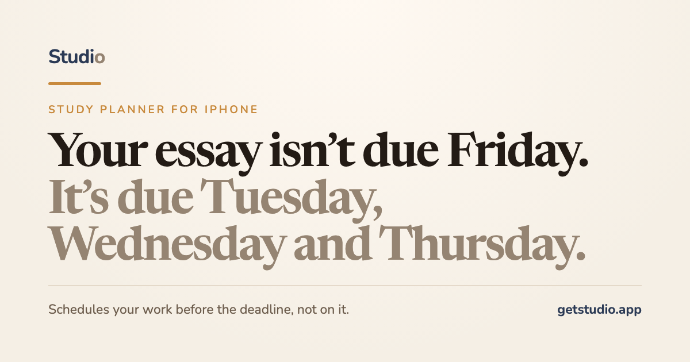

# Studio

**A study planner for iPhone that schedules your work *before* the deadline, not on it.**



Most planners sort assignments by due date. Studio picks a day to actually *work* on each one, spreading tasks across the week so no single night gets buried. A Friday essay shows up on Tuesday, Wednesday, or Thursday instead.

🌐 [getstudio.app](https://www.getstudio.app) · 🏛️ Submitted to the 2026 Congressional App Challenge (IL-08)

> The app's source code is private because Studio is a paid app. This repo shows what it does, how it's built, and a few code samples.

<!-- Add App Store screenshots to /screenshots and uncomment:
| | | |
|---|---|---|
|  |  |  |
-->

## Features

- **Smart scheduler.** Assigns each task to the least busy day before it's due, respects a daily task limit, and has three styles: strict (start early), balanced, and relaxed (start late).
- **Timetable import from a photo.** Take a picture of your schedule or assignment list and Studio reads your classes and tasks with AI.
- **Focus Mode.** A study timer that blocks distracting apps through Apple's Screen Time framework, with a Live Activity on the Lock Screen and Dynamic Island.
- **Widgets.** Home Screen and Lock Screen widgets for today's tasks.
- **Apple Calendar sync, reminders, and streaks.**
- **Sign in with Apple** and full in-app account deletion.

Free tier: up to three classes, unlimited assignments, the full scheduler, widgets, timer, and reminders. **Studio Pro** (subscription or one-time purchase) adds unlimited classes, Focus Mode, photo import, calendar sync, and themes.

## Tech stack

| Area | Tools |
|---|---|
| App | Swift, SwiftUI, iOS 17+ |
| Apple frameworks | WidgetKit, ActivityKit (Live Activities), FamilyControls + ManagedSettings (app blocking), EventKit, AuthenticationServices |
| Backend | Appwrite (auth, database, storage) + Appwrite Functions in Node.js |
| AI | Google Gemini for reading timetables from photos, behind a server-side per-user and global daily limit |
| Payments | RevenueCat + StoreKit |
| Monitoring | Sentry |
| Website | Next.js + Tailwind |

## How it works

```
 iPhone app (SwiftUI)                         Appwrite
 ┌────────────────────────────┐               ┌─────────────────────────────────┐
 │ Smart scheduler (on device)│  auth, rows   │ Database: classes, tasks, prefs │
 │ Widgets + Live Activity    │ ────────────▶ │ Storage: profile pictures       │
 │ Focus Mode (Screen Time)   │               │                                 │
 │ RevenueCat paywall         │  functions    │ account function:               │
 │                            │ ────────────▶ │  · Sign in with Apple           │
 └────────────────────────────┘               │  · password reset               │
                                              │  · delete account               │
                                              │  · read timetable ──▶ Gemini    │
                                              └─────────────────────────────────┘
```

- **The scheduler runs on the device**, so the Today screen updates instantly every time a task changes.
- **Anything that needs a secret runs on the server.** The Gemini key and Apple's private key live only in Appwrite Functions, never in the app.
- **Server functions check who's calling.** Each one reads the user from a header Appwrite sets itself and ignores user IDs sent in the request, so one user can't act on another's account.
- **AI costs are capped server-side.** Photo import has a per-user and a global daily limit stored in a table the app can't write to, so a modified app can't run up the bill.

## Code sample

[`samples/Scheduler.swift`](samples/Scheduler.swift) is the core of the app: the lightest-load-first algorithm that decides which day you work on each task.

## Built by

Dawid Pankiewicz, a high school student in the Chicago area. More projects on [my GitHub](https://github.com/dawidp67).
